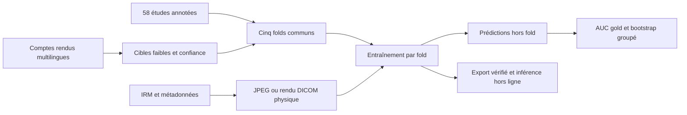

# RSNA Knee Abnormality Detection

**Classification multilabel d’IRM du genou, supervision faible et ensembles de modèles PyTorch.**

Ce projet explore comment apprendre à détecter **12 anomalies** lorsque seules
**58 des 4 407 études** disposent d’annotations manuelles. Il relie l’exploration
des images et des comptes rendus à la validation croisée, l’entraînement et
l’inférence DICOM hors ligne sur Kaggle.

L’apport du projet comprend la préparation des cibles faibles, une baseline à
quatre encodeurs gelés, un pipeline d’affinage de trois familles de modèles,
et les contrôles de reprise et d’export associés. Les méthodes et extraits
adaptés de travaux externes sont attribués dans les [références](references/README.md).

## Parcourir le projet

| Pour découvrir… | Point d’entrée |
|---|---|
| Les données, les plans anatomiques et les séquences IRM | [Notebooks d’exploration](notebooks/exploration/) |
| L’extraction de cibles depuis les comptes rendus | [Supervision faible](notebooks/report_weak_labeling.ipynb) |
| La baseline à encodeurs gelés | [Baseline JPEG](baseline_candidate/README.md) |
| L’affinage CoAtNet, ConvNeXt et DINOv2 | [Ensemble DICOM](finetuned_ensemble/README_FR.md) |
| L’expérience d’auto-supervision par reconstruction | [MAE](notebooks/mae/README.md) |
| Les scores, leur provenance et leurs limites | [Résultats](docs/results/README.md) |

## Du compte rendu à la prédiction



Les rapports identiques restent dans le même fold. La perte tient compte de la
confiance et masque les cibles inconnues. Les expériences distinguent les
annotations manuelles (« gold ») des cibles heuristiques (« weak »).

La baseline utilise CoAtNet, ConvNeXt Small, ConvNeXt Tiny et DINOv2 avec
encodeurs gelés et têtes entraînées. L’ensemble affiné utilise CoAtNet,
ConvNeXt Small et DINOv2 sur des vues 2,5D, avec cinq folds par famille.
Le pipeline DICOM vérifie les codecs, la géométrie et les contrats de reprise.

## Résultats à retenir

| Expérience | Mesure | Résultat |
|---|---|---:|
| MAE + classifieurs linéaires | Macro AUC hors fold, 58 gold | 0,5741 |
| Baseline gelée, mélange fixé `candidate05` | Macro AUC hors fold, 58 gold | **0,7302** |
| Ensemble affiné, mélange principal | Macro AUC gold rapportée dans le journal de travail | 0,6896 |
| Inférence DICOM : série → quatre processus | Secondes par étude, mesure Kaggle sur 50 études | 37,04 → 12,49 |

L’ensemble affiné régresse sur le petit ensemble gold : la baseline reste le
candidat principal. Les AUC sont exploratoires ; **aucun score de leaderboard
propre à ce dépôt n’est établi par les fichiers disponibles**. Les résultats
contre les cibles faibles mesurent l’accord avec les heuristiques. Voir les
[sources et limites](docs/results/README.md) avant toute comparaison.

## Installation et vérification

Cible de développement local : **Python 3.12**. Depuis la racine du dépôt :

```bash
python3.12 -m venv .venv
source .venv/bin/activate
python -m pip install -r requirements/dev.txt
python scripts/check_repository.py
python scripts/run_tests.py
```

Les tests par défaut utilisent des entrées synthétiques, sans téléchargement de
poids ni accès aux données de compétition. GitHub Actions exécute ces mêmes
suites sur CPU. La première exécution distante de cette CI reste à effectuer.

Pour ouvrir les notebooks :

```bash
python -m pip install -r requirements/notebooks.txt
python -m jupyterlab
```

La baseline s’ouvre en mode `inspection`. Le MAE démarre en mode `smoke` ;
son exécution lance un petit entraînement de contrôle. Les entraînements complets
et les téléchargements se configurent dans les notebooks et guides concernés.

Les données s’obtiennent séparément depuis la compétition et se placent dans
[`data/`](data/README.md). Les JPEG utilisés par la baseline et le MAE nécessitent
une conversion préalable : son script d’origine n’est pas présent dans ce dépôt.
Le [guide de reproduction](docs/reproduction.md) précise cette limite et le
parcours DICOM, qui possède son propre rendu dans le code.

## Organisation

```text
├── baseline_candidate/       # Baseline JPEG, CLI, tests et notebooks Kaggle
├── finetuned_ensemble/       # Runtime DICOM, recettes, notebooks et correctifs
├── notebooks/
│   ├── exploration/         # Données et anatomie des acquisitions
│   ├── mae/                 # Auto-supervision et inférence MAE
│   └── report_weak_labeling.ipynb
├── docs/
│   ├── methodology/         # Validation croisée, métadonnées, plan expérimental
│   ├── results/             # Métriques agrégées et provenance
│   └── archive/             # Documents historiques
├── references/              # Attributions et ressources externes
├── requirements/            # Dépendances de développement et d’exploration
├── scripts/                 # Vérification du dépôt et des notebooks
├── data/                    # Guide ; données locales exclues de Git
└── submission/              # Guide MAE ; poids et archives exclus de Git
```

Les images, comptes rendus, identifiants d’études, poids, archives de déploiement,
environnements et sorties détaillées restent locaux. Les notebooks publiables
ne contiennent pas de sorties d’exécution. La préparation et les commandes
Git sont décrites dans le [guide GitHub](docs/github.md).

## Méthode et attribution

- [Stratégie de validation croisée](docs/methodology/cross_validation_strategy.md)
- [Référence des métadonnées](docs/methodology/metadata_reference.md)
- [Règles d’extraction des anomalies](docs/methodology/injury_regex_patterns.md)
- [Protocole de l’ensemble affiné](finetuned_ensemble/PROTOCOLE_COMMUN_FR.md)
- [Références et provenance](references/README.md)
- [Notice de réutilisation](NOTICE.md)

Les CSV disponibles ne démontrent pas l’indépendance des patients. L’extracteur
de labels faibles a déjà été audité sur les gold ; les scores ne constituent
donc pas une validation entièrement indépendante de cette étape. Ce travail
présente une expérimentation de compétition, sans validation clinique.
